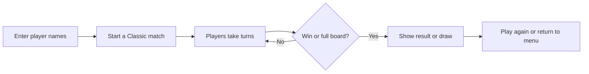

# Graffiti Grid

A browser-based Tic-Tac-Toe game for two players, built as a CPSC 362 project.

## Table of Contents

- [Project Description](#project-description)
- [Tech Stack](#tech-stack)
- [Features](#features)
- [Getting Started](#getting-started)
- [Directory Structure](#directory-structure)
- [How a Local Match Works](#how-a-local-match-works)
- [Current Status](#current-status)

## Project Description

Graffiti Grid is a small browser game for classmates, friends, or anyone who wants to play Tic-Tac-Toe together on one computer. Each player chooses a name, then players take turns placing X and O on a 3 × 3 board. The game announces a win or draw and lets players start another round.

The current version is local, same-screen play. It gives players a quick game without accounts or a hosted server. Blitz mode and online rooms are planned, but they are not available in the current application.

## Tech Stack

- **Language:** Python 3
- **Web framework:** NiceGUI 3.18.0, for the browser interface and local app server
- **Game logic:** Python, using the standard library
- **Dependencies:** Pinned in `requirements.txt`
- **Database:** None is used by the current local game. Supabase packages are listed for planned online play, but the app does not connect to Supabase yet.
- **Code checks:** GitHub Actions runs Super-Linter when changes are pushed.

## Features

### Available now

- Two players can play Classic mode on the same screen.
- Players can enter different display names.
- X starts, and players alternate turns.
- The game prevents moves in occupied squares and moves after a round ends.
- Three matching pieces in a row, column, or diagonal wins; a full board without a winner is a draw.
- The interface includes instructions, winning-square highlights, a result screen, and a Play Again option.

### Planned

- Blitz mode, where each player can keep up to three pieces on the board.
- Private online rooms and other multiplayer features.

These planned features are not implemented in the current version.

## Getting Started

You need Python 3 installed.

1. Open a terminal in the project folder.
2. Create and activate a virtual environment.

   **macOS or Linux:**

   ```bash
   python3 -m venv .venv
   source .venv/bin/activate
   ```

   **Windows PowerShell:**

   ```powershell
   python -m venv .venv
   .\.venv\Scripts\Activate.ps1
   ```

3. Install the project dependencies and start the game:

   ```bash
   python -m pip install -r requirements.txt
   python main.py
   ```

4. Open [http://127.0.0.1:8080](http://127.0.0.1:8080) in your browser.

## Directory Structure

The runnable application is currently on the `mohammed-python` branch. The structure below describes that branch.

```text
CPSC-362/
├── .github/
│   └── workflows/
│       └── ci.yml             # Runs Super-Linter on pushes
├── docs/
│   └── requirements.md        # Project scope and planned requirements
├── .gitignore                 # Files Git should ignore
├── TicTacToe                  # Older placeholder; not used by the app
├── game_engine.py             # Classic game rules and board state
├── game_screen.py             # Menus, player setup, and game interface
├── main.py                    # Starts the NiceGUI app on port 8080
├── requirements.txt           # Python dependency versions
└── README.md                  # Project overview and run instructions
```

## How a Local Match Works



## Current Status

The current working branch supports local Classic matches. The repository's default `main` branch is still a starter scaffold; the runnable Python application is on `mohammed-python`. For the README to be visible from the default branch and alongside the working code, keep a copy in both branches.
